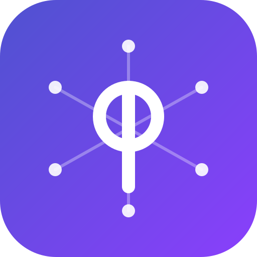

<!-- README.md -->
# rhosocial-activerecord ($\rho_{\mathbf{AR}}$)

[](https://badge.fury.io/py/rhosocial-activerecord)
[](https://pypi.org/project/rhosocial-activerecord/)
[](https://github.com/rhosocial/python-activerecord/actions)
[](https://app.codecov.io/gh/rhosocial/python-activerecord/tree/main)
[](https://github.com/rhosocial/python-activerecord/blob/main/LICENSE)
[](https://github.com/vistart)

<div align="center">
    
    <h3>A Modern, Standalone ActiveRecord Implementation for Python</h3>
    <p><b>Built on Pydantic Only · Full Type Safety · True Sync-Async Parity · AI-Native Design</b></p>
</div>

**Keywords:** orm, activerecord, pydantic, python, sqlite, async, type-safe

## Why This Project?

### 1. The ActiveRecord pattern is intuitive

A class represents a table; an instance represents a row. That maps directly to how developers think:

```python
user = User(name="Alice")  # Create
user.save()                # Persist
user.name = "Bob"          # Modify
user.save()                # Update
```

Simple, consistent, easy to reason about — with no Session object to manage.

### 2. Python lacks a *standalone* ActiveRecord ecosystem

| | rhosocial-activerecord | SQLAlchemy | Django ORM |
|---|---|---|---|
| **Pattern** | ActiveRecord | Data Mapper | ActiveRecord (coupled) |
| **Standalone** | ✅ Yes | ✅ Yes | ❌ Django only |
| **Core dependency** | Pydantic only | Self-contained | Django framework |
| **Session concept** | ❌ None | ✅ Required | ⚠️ Implicit |
| **Query style** | Expression objects + `.to_sql()` | Expression language / ORM | QuerySet chaining |
| **SQL transparency** | Every query exposes `.to_sql()` | Via `compile()` | Limited via `.query` |
| **Async** | Native parity (same API + `await`) | 2.0 via greenlet | 4.1+ only |

* **SQLAlchemy** is excellent, but follows the Data Mapper pattern — not ActiveRecord.
* **Django ORM** is ActiveRecord but **tightly coupled** to Django; you cannot use it in FastAPI, Flask, or a plain script without the whole framework.
* **We fill the gap:** a standalone, modern, type-safe ActiveRecord for any Python application.

### 3. Built from scratch, not a wrapper

**Traditional ORM architecture:** Your Code → ORM API → SQLAlchemy/Django → Driver → Database

**Our architecture:** Your Code → rhosocial-activerecord → Driver → Database

There is no SQLAlchemy underneath and no Django ORM wrapper — just Pydantic as the only dependency. That means zero hidden complexity, complete SQL control, a smaller footprint, and one layer to understand instead of three.

## Quick Start

### Installation

```bash
pip install rhosocial-activerecord
```

Requires Python 3.8+. The example below uses the built-in, in-memory SQLite backend.

### End-to-End Example

```python
"""Save as demo.py and run with: python demo.py"""
from typing import Annotated, ClassVar

from rhosocial.activerecord.backend.impl.sqlite.backend import SQLiteBackend
from rhosocial.activerecord.backend.impl.sqlite.config import SQLiteConnectionConfig
from rhosocial.activerecord.backend.expression.types import VarCharType
from rhosocial.activerecord.base import FieldProxy, UseSqlType
from rhosocial.activerecord.field import DefaultTimestampMixin, IntegerPKMixin
from rhosocial.activerecord.model import ActiveRecord


class User(IntegerPKMixin, DefaultTimestampMixin, ActiveRecord):
    name: Annotated[str, UseSqlType(VarCharType(length=100))]
    email: Annotated[str, UseSqlType(VarCharType(length=255))]
    age: int = 0

    c: ClassVar[FieldProxy] = FieldProxy()  # enables User.c.<field> expressions

    @classmethod
    def table_name(cls) -> str:
        return "users"


# Configure the backend and create the table from the model declaration
User.configure(SQLiteConnectionConfig(database=":memory:"), SQLiteBackend)
User.create_table()

# Create
alice = User(name="Alice", email="alice@example.com", age=30)
alice.save()
print(alice.id)  # database-assigned integer primary key

# Query with type-safe expressions
adults = User.query().where(User.c.age >= 18).all()
print([user.name for user in adults])

# Inspect the generated SQL without executing it
sql, params = User.query().where(User.c.age >= 18).to_sql()
print(sql, params)  # SELECT ... FROM "users" WHERE "users"."age" >= ?   (18,)
```

> **Async parity:** use `AsyncActiveRecord` with `AsyncSQLiteBackend` for the async model — same method names, same patterns, just add `await`.

## Project Architecture

```
Your Code
   ↓
Interface        models, field proxies, mixins, query builders, events
   ↓
ActiveRecord     lifecycle, persistence, relations
   ↓
Expressions      backend-agnostic declarations → generic statements
   ↓
Dialect          binds expressions to concrete SQL
   ↓
Driver           built-in SQLite backend → database
```

For the full picture, start with the [Documentation](docs/en_US/README.md) and read [The ActiveRecord Definition](docs/en_US/modeling/definition.md) — the authoritative, up-to-date overview of how a model is declared.

**Expression–dialect separation.** Query structure and SQL generation are completely decoupled. Expressions describe *what* you want; a dialect decides *how* it is spelled in SQL. Nothing is rendered until an explicit `.to_sql()` call, so you can preview and verify every statement before it runs.

**True sync–async parity.** Both implementations are native, not async wrappers around sync code. Method names and patterns are identical; the async variant just adds `await`.

**Type-first design with Pydantic v2.** Every field is typed, validated, and IDE-friendly, with autocomplete and runtime validation and no `Any` types in the public API.

## Backend Support & Progress

SQLite is built in and is the backend used throughout this README and the core documentation. Other database backends ship as separate packages, each documented in its own repository; the core library and its docs describe ActiveRecord and the built-in SQLite backend only.

> **⚠️ Development Stage:** This project is under active development. APIs may change, and some features are not yet production-ready.

## Contributing, License, Links

### Contributing

We welcome contributions! Please see [CONTRIBUTING.md](CONTRIBUTING.md) for guidelines.

### License

[Apache License 2.0](LICENSE) — Copyright © 2026 [vistart](https://github.com/vistart)

### Documentation

* **[Documentation Home](docs/en_US/README.md)** — the full documentation table of contents
* **[The ActiveRecord Definition](docs/en_US/modeling/definition.md)** — authoritative model-declaration reference
* **[Getting Started Guide](docs/en_US/getting_started/)** — installation and basic usage
* **[Modeling Guide](docs/en_US/modeling/)** — defining models, fields, and relationships
* **[Querying Guide](docs/en_US/querying/)** — complete query builder documentation
* **[Backend Development](docs/en_US/backend/)** — creating custom database backends
* **[Architecture Overview](docs/en_US/introduction/architecture.md)** — module structure and design decisions
* **[AI-Assisted Development](docs/en_US/introduction/ai_assistance.md)** — using AI code agents with this project
* **[LLM Context](docs/LLM_CONTEXT.md)** — structured context for AI assistants
* **[API Reference](https://docs.python-activerecord.dev.rho.social/api/)** — full API documentation

### Get Started with AI Code Agents

This project ships with built-in configurations for AI code agents and editors. Clone the repo and launch your preferred tool — project-specific skills, commands, and context files are discovered automatically.

```bash
git clone https://github.com/rhosocial/python-activerecord.git
cd python-activerecord
```

**CLI code agents**

| Tool | How to start | What's included |
|---|---|---|
| [Claude Code](https://docs.anthropic.com/en/docs/claude-code) | `claude` | `CLAUDE.md` project instructions + `.claude/skills/` (5 skills) + `.claude/commands/` |
| [OpenCode](https://github.com/opencode-ai/opencode) | `opencode` | `.opencode/commands/` (8 slash commands) + `.opencode/hints.yml` |
| [Codex](https://github.com/openai/codex) | `codex` | `AGENTS.md` project context |

**Editors**

[Cursor](https://cursor.com) and [Windsurf](https://windsurf.com) users can open the project folder directly. Both benefit from the `CLAUDE.md` and `AGENTS.md` context files at the project root, as well as the `docs/LLM_CONTEXT.md` structured reference.

**For any LLM**

Feed [`docs/LLM_CONTEXT.md`](docs/LLM_CONTEXT.md) to your preferred LLM for a structured overview of the architecture, module map, and key concepts. See the **[AI-Assisted Development Guide](docs/en_US/introduction/ai_assistance.md)** for concrete examples of what agents can help with — from generating models and queries to implementing backends and running tests.

---

<div align="center">
    <p><b>Built with ❤️ by the rhosocial team</b></p>
    <p><a href="https://github.com/rhosocial/python-activerecord">GitHub</a> · <a href="https://docs.python-activerecord.dev.rho.social/">Documentation</a> · <a href="https://pypi.org/project/rhosocial-activerecord/">PyPI</a></p>
</div>
