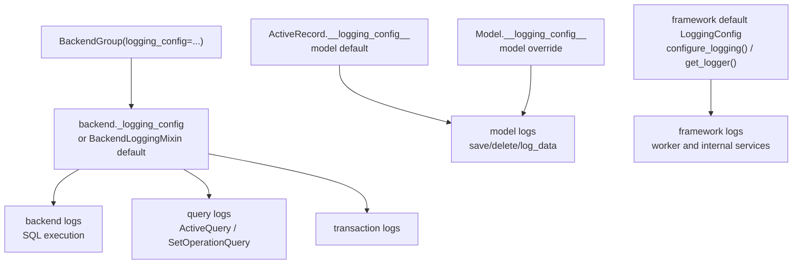

# Logging System

The logging system provides isolated loggers and configurable data summarization without mutating the application's root logger.

## Configuration Ownership

There is no logging manager singleton. Logging configuration belongs to one of these owners:

1. **ActiveRecord default**: `ActiveRecord.__logging_config__` controls model logging for models that do not override it.
2. **Model override**: `Model.__logging_config__` controls one concrete model class.
3. **Backend config**: a backend instance or `BackendGroup(..., logging_config=...)` controls backend, query, and transaction logs.
4. **Framework default**: `configure_logging()` and `get_logger(name)` are only for framework-level loggers that are not owned by a model or backend.



## Quiet by Default

The application owns logging. ActiveRecord does not install handlers, does not
write to stderr on import, and does not touch the root logger:

| Setting | Default | Meaning |
| ------- | ------- | ------- |
| `LoggingConfig.default_level` | `logging.WARNING` | `DEBUG` / `INFO` records stay silent until the application asks for them |
| `LoggingConfig.auto_setup` | `False` | the library never attaches a `StreamHandler` of its own |
| `LoggingConfig.propagate` | `True` | library loggers hand records to the application's root handlers |

Importing `rhosocial.activerecord` only creates configuration objects and
logger names; it emits no records. To see more, either raise the library level
or configure the root logger:

```python
import logging

logging.basicConfig(level=logging.DEBUG)          # application handler
logging.getLogger("rhosocial.activerecord").setLevel(logging.DEBUG)
```

An explicitly set level is never overwritten. While `default_level` is the
quiet `WARNING`, loggers stay `NOTSET` so they inherit the application's root
level; a non-default level, or a per-logger `LoggerConfig`, is written
explicitly.

## Quick Start

```python
import logging
from typing import Optional

from rhosocial.activerecord.logging import LoggingConfig, LogDataMode
from rhosocial.activerecord.model import ActiveRecord

ActiveRecord.__logging_config__ = LoggingConfig(
    default_level=logging.INFO,
    log_data_mode=LogDataMode.SUMMARY,
)

class User(ActiveRecord):
    __table_name__ = "users"
    id: Optional[int] = None
    username: str
    password: str

class AuditUser(ActiveRecord):
    __table_name__ = "audit_users"
    __logging_config__ = LoggingConfig(log_data_mode=LogDataMode.KEYS_ONLY)
    id: Optional[int] = None
    username: str
    password: str
```

## Framework-Level Loggers

Use `configure_logging()` only for framework loggers outside model/backend ownership:

```python
import logging
from rhosocial.activerecord.logging import configure_logging, get_logger

configure_logging(level=logging.INFO)  # propagate stays True; the root decides
logger = get_logger("rhosocial.activerecord.worker")
```

## Data Modes

`LoggingConfig.log_data_mode` accepts `LogDataMode` enum values:

| Mode | Behavior |
| ---- | -------- |
| `LogDataMode.HIDDEN` | Hide the entire payload as `"<hidden>"` |
| `LogDataMode.KEYS_ONLY` | Show keys and type hints, mask sensitive fields |
| `LogDataMode.SUMMARY` | Mask sensitive fields and truncate large values |
| `LogDataMode.FULL` | Show full payload; only use in controlled debugging |

## Logging in Web Applications

In web apps like FastAPI, beyond the framework's `LoggingConfig`, you typically want unified application log output. Following real-world practice (e.g. the webcrawler project), combine:

1. **`ActiveRecordFormatter`**: the framework's formatter providing a unified format (`module:line`) across ORM internal logs and application logs:

```python
from rhosocial.activerecord.logging import ActiveRecordFormatter

formatter = ActiveRecordFormatter()
# default format: %(asctime)s - %(levelname)s - [%(subpackage_module)s] - %(message)s
# example: 2024-01-15 10:30:45,123 - DEBUG - [rhosocial.activerecord.backend.base:42] - Executing query: ...
```

2. **File rotation + console dual output**: `TimedRotatingFileHandler` rotates by time (hour/day), plus a `StreamHandler` to stderr:

```python
import logging
import sys
from logging.handlers import TimedRotatingFileHandler
from pathlib import Path

from rhosocial.activerecord.logging import ActiveRecordFormatter

def setup_logging(log_dir="logs", log_filename="app", level="INFO", when="d", backup_count=7):
    Path(log_dir).mkdir(parents=True, exist_ok=True)
    formatter = ActiveRecordFormatter()

    file_handler = TimedRotatingFileHandler(
        filename=str(Path(log_dir) / f"{log_filename}.log"),
        when=when, backupCount=backup_count, encoding="utf-8",
    )
    file_handler.setFormatter(formatter)

    console_handler = logging.StreamHandler(sys.stderr)
    console_handler.setFormatter(formatter)

    root = logging.getLogger()
    root.setLevel(getattr(logging, level.upper(), logging.INFO))
    root.handlers.clear()
    root.addHandler(file_handler)
    root.addHandler(console_handler)

    # route uvicorn access/error logs to root for unified formatting
    for name in ("uvicorn", "uvicorn.access", "uvicorn.error"):
        uv = logging.getLogger(name)
        uv.handlers.clear()
        uv.propagate = True
```

3. **Wire into the FastAPI lifespan**: call once at startup; afterwards ORM internal logs (SQL execution, model ops), application logs, and uvicorn access logs share one format.

> **Relationship with framework `LoggingConfig`**: the framework's model/backend loggers are managed by their own `LoggingConfig`, which propagates to the root by default and installs no handler. The setup above is the **application layer** attaching handlers to the root and explicitly routing uvicorn — the two do not conflict: framework logs inherit the root handlers (with `LoggingConfig` responsible for sensitive-data masking), application logs use those handlers too.

A complete runnable example is in the [FastAPI Integration scenario](../scenarios/fastapi.md#7-logging-configuration) (`docs/examples/chapter_14_scenarios/fastapi_blog/app/logging_conf.py`).

## Structured Events

`log_event()` writes a stable event name and a structured payload:

```python
import logging
from rhosocial.activerecord.logging import LogEvent, log_event

logger = logging.getLogger("rhosocial.activerecord.model.User")

log_event(
    logger,
    LogEvent.DML_INSERT,
    model="User",
    model_fqn="app.models.User",
    object_name="users",
    object_type="table",
    schema="public",
    rows_affected=1,
    duration_ms=12.4,
)
```

The record carries:

```python
record.event == "dml.insert"
record.activerecord == {
    "model": "User",
    "model_fqn": "app.models.User",
    "object_name": "users",
    "object_type": "table",
    "schema": "public",
    "rows_affected": 1,
    "duration_ms": 12.4,
}
```

Event names are grouped by statement/operation:

```text
dml.insert / dml.update / dml.delete / dml.batch
dql.select / dql.aggregate / dql.cte / dql.set_operation
ddl.create / ddl.alter / ddl.drop
transaction.begin / transaction.commit / transaction.rollback / transaction.savepoint
model.find_one / model.find_one_or_create
relation.batch_load
worker.exit
```

Recommended fields:

| Field | Meaning |
| ----- | ------- |
| `model` | Model class name, e.g. `User` |
| `model_fqn` | Fully qualified model name, e.g. `app.models.User` |
| `operation` | `select`, `insert`, `update`, `delete`, `batch`, ... |
| `object_name` | Logical table/view name, e.g. `users` |
| `object_type` | `table`, `view`, `materialized_view` |
| `schema` | Schema name, when known |
| `database` | Database/catalog name, when known |
| `rows_affected` | DML affected rows |
| `rows_returned` | DQL returned rows |
| `parameter_sets` | Batch parameter-set count |
| `param_count` | Parameter count, never a parameter value |
| `duration_ms` | Operation duration |
| `relation` | Relation name |
| `cache_hit` | Relation cache hit flag |
| `error_type` | Exception type |

Do not use `table` as a single "fully qualified" field.  A logical name plus
`schema`, `database` and `object_type` keeps tables and views unambiguous.

## Event Formatters

`ActiveRecordEventFormatter` renders the event template with the usual
human-readable prefix:

```python
from rhosocial.activerecord.logging import ActiveRecordEventFormatter

handler.setFormatter(
    ActiveRecordEventFormatter(
        templates={"dml.insert": "insert {model} into {object_name}"}
    )
)
```

`ActiveRecordJsonFormatter` emits one JSON object per line:

```python
from rhosocial.activerecord.logging import ActiveRecordJsonFormatter

handler.setFormatter(ActiveRecordJsonFormatter())
```

```json
{
  "@timestamp": "2026-11-10T10:15:30.123Z",
  "level": "INFO",
  "logger": "rhosocial.activerecord.model.User",
  "message": "dml.insert model=User object_name=users object_type=table rows_affected=1 duration_ms=12.4",
  "event": "dml.insert",
  "model": "User",
  "model_fqn": "app.models.User",
  "object_name": "users",
  "object_type": "table",
  "schema": "public",
  "rows_affected": 1,
  "duration_ms": 12.4
}
```

## Redacting Query Parameters

`LoggingConfig.redact()` takes a `LogPayload` and applies the configured data
mode:

```python
from rhosocial.activerecord.logging import LogDataKind, LogPayload

payload = LogPayload(
    ("alice", "secret"),
    LogDataKind.QUERY_PARAMS,
    param_names=("name", "password"),
    sensitive_names=("password",),
)
redacted = ActiveRecord.__logging_config__.redact(payload)
# {"name": "alice", "password": "***MASKED***"}
```

Positional parameters without names are never printed by default:

```python
LogPayload(("alice", "secret"), LogDataKind.QUERY_PARAMS)
# "<2 params: str, str>"
```

Use `SensitiveValue` for an ad-hoc value that must be masked:

```python
from rhosocial.activerecord.logging import SensitiveValue, unwrap_sensitive

lookup_value = SensitiveValue("secret", masker="default")
# SQL assembly must use unwrap_sensitive(lookup_value)
```

`unwrap_sensitive()` recursively unwraps lists, tuples, sets and dictionaries.
The database must receive the original value; only the log payload uses the
masked representation.

The default sensitive field names include common credential names such as
`password`, `token`, `secret`, `api_key` and `private_key`.  Use
`LogDataMode.FULL` only for controlled debugging: it intentionally disables
masking.

## Correlation IDs in JSON Logs

`ActiveRecordJsonFormatter` includes `request_id`, `trace_id` and `span_id`
when a logging filter sets them on the record.  A typical web application uses
`contextvars` plus a filter:

```python
import contextvars
import logging

request_id_var = contextvars.ContextVar("request_id", default=None)

class RequestIdFilter(logging.Filter):
    def filter(self, record):
        record.request_id = request_id_var.get()
        return True
```

Then any library logger that propagates to the same handler carries the
request ID.  OpenTelemetry users can set `trace_id` and `span_id` from the
current span; the JSON formatter does not depend on OpenTelemetry.

## Execution Logging Contract

SQL text and parameter values belong to the backend execution layer:

- `DEBUG` records SQL and redacted parameters.
- `INFO` records a DML/DQL/DDL/TCL summary without SQL or values.
- Query objects pass model/operation/parameter metadata to the backend instead
  of logging the same SQL a second time.
- Exceptions that are re-raised are not logged again as `ERROR`.

Example summaries:

```text
dml.insert model=User object_name=users object_type=table rows_affected=1 duration_ms=12.4
dql.select model=User object_name=users object_type=table rows_returned=3 duration_ms=12.4
dml.batch model=User operation=insert_many parameter_sets=100 rows_affected=100 duration_ms=120.5
```

### Passing execution context

`ExecutionOptions.log_context` and the `log_context` keyword on
`fetch_all()`/`fetch_one()` tell the backend what a statement means:

```python
from rhosocial.activerecord.backend.options import ExecutionOptions, LogContext
from rhosocial.activerecord.backend.schema import StatementType

backend.execute(
    'INSERT INTO "users" ("name") VALUES (?)',
    ("alice",),
    options=ExecutionOptions(
        stmt_type=StatementType.DML,
        log_context=LogContext(model=User, operation="insert", object_name="users"),
    ),
)
```

`LogContext.param_meta` accepts `ParamMeta` entries when a caller knows which
positional parameter belongs to which field; without metadata the `DEBUG`
record shows only the parameter count and Python types. Custom backends that
override `fetch_all()`/`fetch_one()` must accept `log_context` and forward it
to their `ExecutionOptions`.

## Local ELK Verification

A local Elasticsearch + Logstash + Kibana stack is useful for validating the
JSON event schema, but it is a development tool and is not part of this
repository.  Use `ActiveRecordJsonFormatter` with a file or TCP handler, map
`event`, `model`, `object_name`, `object_type`, `request_id`, `trace_id` and
`span_id` as `keyword`, and index numeric fields such as `rows_affected` and
`duration_ms` as numbers.

Kibana queries:

```text
event: "dml.insert"
event: "dql.select" and duration_ms > 100
request_id: "req-..."
model: "User" and rows_affected > 1
```

## Example Code

Complete examples are in `docs/examples/chapter_09_logging/`:

| File | Description |
| ---- | ----------- |
| [01_basic_configuration.py](../../examples/chapter_09_logging/01_basic_configuration.py) | ActiveRecord defaults, model override, framework logger config |
| [02_data_summarization.py](../../examples/chapter_09_logging/02_data_summarization.py) | `LogDataMode` and `SummarizerConfig` |
| [03_per_logger_config.py](../../examples/chapter_09_logging/03_per_logger_config.py) | Per-logger rules inside owning `LoggingConfig` objects |
| [04_advanced_scenarios.py](../../examples/chapter_09_logging/04_advanced_scenarios.py) | Production/development presets and `BackendGroup` |
| [05_logging_levels.py](../../examples/chapter_09_logging/05_logging_levels.py) | Default quiet behavior vs explicit INFO/DEBUG levels |
| [06_structured_events.py](../../examples/chapter_09_logging/06_structured_events.py) | Event schema, `ActiveRecordEventFormatter` and `ActiveRecordJsonFormatter` |
| [07_redaction_modes.py](../../examples/chapter_09_logging/07_redaction_modes.py) | Query-parameter redaction, `LogDataMode` and `SensitiveValue` |
| [08_correlation_ids.py](../../examples/chapter_09_logging/08_correlation_ids.py) | `contextvars` correlation IDs in JSON logs |
| [09_execution_logging.py](../../examples/chapter_09_logging/09_execution_logging.py) | Quiet default, INFO summaries and DEBUG SQL from the backend |

```bash
cd python-activerecord
source .venv3.8/bin/activate
python docs/examples/chapter_09_logging/01_basic_configuration.py
```

