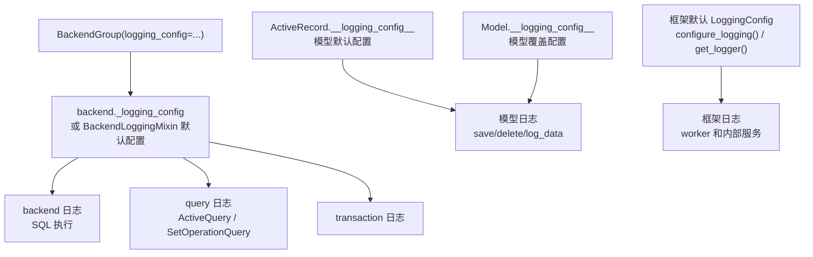

# 日志系统

`rhosocial-activerecord` 日志系统提供隔离的日志器和可配置的数据摘要能力，不会修改应用程序根日志器。

## 配置归属

现在没有 logging manager singleton。日志配置只属于以下归属点之一：

1. **ActiveRecord 默认配置**：`ActiveRecord.__logging_config__` 控制未覆盖配置的模型日志。
2. **具体模型配置**：`Model.__logging_config__` 控制单个模型类。
3. **backend 配置**：backend 实例或 `BackendGroup(..., logging_config=...)` 控制 backend、query、transaction 日志。
4. **非模型框架默认配置**：`configure_logging()` 和 `get_logger(name)` 仅用于不归属 model/backend 的框架日志器。



## 默认保持安静

日志由应用掌控。ActiveRecord 不安装 handler、导入时不向 stderr 输出、也不修改根日志器：

| 配置 | 默认值 | 含义 |
| ---- | ------ | ---- |
| `LoggingConfig.default_level` | `logging.WARNING` | 应用主动开启之前，`DEBUG` / `INFO` 记录保持静默 |
| `LoggingConfig.auto_setup` | `False` | 库不会自行挂载 `StreamHandler` |
| `LoggingConfig.propagate` | `True` | 库日志器把记录交给应用的根日志器 handler |

导入 `rhosocial.activerecord` 只创建配置对象和日志器名称，不输出任何记录。
需要更多细节时，提高库的日志级别或配置根日志器：

```python
import logging

logging.basicConfig(level=logging.DEBUG)          # 应用侧 handler
logging.getLogger("rhosocial.activerecord").setLevel(logging.DEBUG)
```

应用显式设置的级别不会被覆盖。当 `default_level` 为安静的 `WARNING` 时，
日志器保持 `NOTSET`，从而继承应用的根日志器级别；非默认级别或 per-logger
`LoggerConfig` 才会显式写入。

## 快速开始

```python
import logging
from typing import Optional

from rhosocial.activerecord.logging import LoggingConfig, LogDataMode
from rhosocial.activerecord.model import ActiveRecord

ActiveRecord.__logging_config__ = LoggingConfig(
    default_level=logging.INFO,
    log_data_mode=LogDataMode.SUMMARY,
)

class User(ActiveRecord):
    __table_name__ = "users"
    id: Optional[int] = None
    username: str
    password: str

class AuditUser(ActiveRecord):
    __table_name__ = "audit_users"
    __logging_config__ = LoggingConfig(log_data_mode=LogDataMode.KEYS_ONLY)
    id: Optional[int] = None
    username: str
    password: str
```

## 非模型框架日志器

`configure_logging()` 只用于 model/backend 归属之外的框架日志器：

```python
import logging
from rhosocial.activerecord.logging import configure_logging, get_logger

configure_logging(level=logging.INFO)  # propagate 保持 True，由根日志器决定
logger = get_logger("rhosocial.activerecord.worker")
```

## 数据模式

`LoggingConfig.log_data_mode` 使用 `LogDataMode` 枚举：

| 模式 | 行为 |
| ---- | ---- |
| `LogDataMode.HIDDEN` | 整个 payload 显示为 `"<hidden>"` |
| `LogDataMode.KEYS_ONLY` | 只显示 key 和类型提示，敏感字段仍会被屏蔽 |
| `LogDataMode.SUMMARY` | 屏蔽敏感字段并截断大值 |
| `LogDataMode.FULL` | 显示完整 payload，仅适合受控调试 |

## Web 应用中的日志落地

在 FastAPI 等 Web 应用中，除了框架的 `LoggingConfig`，通常还需要统一的应用日志输出。参考真实项目实践（如 webcrawler），推荐组合使用：

1. **`ActiveRecordFormatter`**：框架提供的格式化器，为 ORM 内部日志（`模块:行号`）与应用日志提供统一格式：

```python
from rhosocial.activerecord.logging import ActiveRecordFormatter

formatter = ActiveRecordFormatter()
# 默认格式：%(asctime)s - %(levelname)s - [%(subpackage_module)s] - %(message)s
# 输出示例：2024-01-15 10:30:45,123 - DEBUG - [rhosocial.activerecord.backend.base:42] - Executing query: ...
```

2. **文件轮转 + 控制台双输出**：`TimedRotatingFileHandler` 按时间轮转（小时/天），配合 `StreamHandler` 输出到 stderr：

```python
import logging
import sys
from logging.handlers import TimedRotatingFileHandler
from pathlib import Path

from rhosocial.activerecord.logging import ActiveRecordFormatter

def setup_logging(log_dir="logs", log_filename="app", level="INFO", when="d", backup_count=7):
    Path(log_dir).mkdir(parents=True, exist_ok=True)
    formatter = ActiveRecordFormatter()

    file_handler = TimedRotatingFileHandler(
        filename=str(Path(log_dir) / f"{log_filename}.log"),
        when=when, backupCount=backup_count, encoding="utf-8",
    )
    file_handler.setFormatter(formatter)

    console_handler = logging.StreamHandler(sys.stderr)
    console_handler.setFormatter(formatter)

    root = logging.getLogger()
    root.setLevel(getattr(logging, level.upper(), logging.INFO))
    root.handlers.clear()
    root.addHandler(file_handler)
    root.addHandler(console_handler)

    # 让 uvicorn 的访问/错误日志转发到 root，与 ORM 日志格式统一
    for name in ("uvicorn", "uvicorn.access", "uvicorn.error"):
        uv = logging.getLogger(name)
        uv.handlers.clear()
        uv.propagate = True
```

3. **整合进 FastAPI lifespan**：应用启动时调用一次，之后 ORM 内部日志（SQL 执行、模型操作）与应用日志、uvicorn 访问日志共用同一套格式。

> **与框架 `LoggingConfig` 的关系**：框架的模型/后端日志器由各自的 `LoggingConfig` 管理，默认向根日志器传播且不安装 handler。上面的落地方式是**应用层**将 handler 挂到 root，并显式让 uvicorn 转发——两者不冲突：框架日志沿用 root 的 handler（敏感信息屏蔽仍由 `LoggingConfig` 负责），应用日志也由这些 handler 统一输出。

完整的可运行示例见 [FastAPI 集成场景](../scenarios/fastapi.md#7-日志配置)（`docs/examples/chapter_14_scenarios/fastapi_blog/app/logging_conf.py`）。

## 结构化事件

`log_event()` 写入稳定的事件名和结构化 payload：

```python
import logging
from rhosocial.activerecord.logging import LogEvent, log_event

logger = logging.getLogger("rhosocial.activerecord.model.User")

log_event(
    logger,
    LogEvent.DML_INSERT,
    model="User",
    model_fqn="app.models.User",
    object_name="users",
    object_type="table",
    schema="public",
    rows_affected=1,
    duration_ms=12.4,
)
```

记录会携带：

```python
record.event == "dml.insert"
record.activerecord == {
    "model": "User",
    "model_fqn": "app.models.User",
    "object_name": "users",
    "object_type": "table",
    "schema": "public",
    "rows_affected": 1,
    "duration_ms": 12.4,
}
```

事件名按语句类型分组：

```text
dml.insert / dml.update / dml.delete / dml.batch
dql.select / dql.aggregate / dql.cte / dql.set_operation
ddl.create / ddl.alter / ddl.drop
transaction.begin / transaction.commit / transaction.rollback / transaction.savepoint
model.find_one / model.find_one_or_create
relation.batch_load
worker.exit
```

建议字段：

| 字段 | 含义 |
| ---- | ---- |
| `model` | 模型简单类名，如 `User` |
| `model_fqn` | 模型完全限定名，如 `app.models.User` |
| `operation` | `select`、`insert`、`update`、`delete`、`batch` 等 |
| `object_name` | 逻辑表名/视图名，如 `users` |
| `object_type` | `table`、`view`、`materialized_view` |
| `schema` | schema 名，可为空 |
| `database` | database/catalog 名，可为空 |
| `rows_affected` | DML 影响行数 |
| `rows_returned` | DQL 返回行数 |
| `parameter_sets` | 批量参数组数 |
| `param_count` | 参数数量，不是参数值 |
| `duration_ms` | 耗时 |
| `relation` | 关系名 |
| `cache_hit` | 关系缓存命中标记 |
| `error_type` | 异常类型 |

不要用单个 `table` 字段表示“完全限定表名”。逻辑名配合 `schema`、
`database` 和 `object_type`，才能无歧义地区分表和视图。

## 事件格式化器

`ActiveRecordEventFormatter` 使用事件模板，并保留可读前缀：

```python
from rhosocial.activerecord.logging import ActiveRecordEventFormatter

handler.setFormatter(
    ActiveRecordEventFormatter(
        templates={"dml.insert": "insert {model} into {object_name}"}
    )
)
```

`ActiveRecordJsonFormatter` 输出每行一个 JSON：

```python
from rhosocial.activerecord.logging import ActiveRecordJsonFormatter

handler.setFormatter(ActiveRecordJsonFormatter())
```

```json
{
  "@timestamp": "2026-11-10T10:15:30.123Z",
  "level": "INFO",
  "logger": "rhosocial.activerecord.model.User",
  "message": "dml.insert model=User object_name=users object_type=table rows_affected=1 duration_ms=12.4",
  "event": "dml.insert",
  "model": "User",
  "model_fqn": "app.models.User",
  "object_name": "users",
  "object_type": "table",
  "schema": "public",
  "rows_affected": 1,
  "duration_ms": 12.4
}
```

## 查询参数脱敏

`LoggingConfig.redact()` 接收 `LogPayload`，按配置的数据模式处理：

```python
from rhosocial.activerecord.logging import LogDataKind, LogPayload

payload = LogPayload(
    ("alice", "secret"),
    LogDataKind.QUERY_PARAMS,
    param_names=("name", "password"),
    sensitive_names=("password",),
)
redacted = ActiveRecord.__logging_config__.redact(payload)
# {"name": "alice", "password": "***MASKED***"}
```

无名称的位置参数默认不输出值：

```python
LogPayload(("alice", "secret"), LogDataKind.QUERY_PARAMS)
# "<2 params: str, str>"
```

临时值可以使用 `SensitiveValue`：

```python
from rhosocial.activerecord.logging import SensitiveValue, unwrap_sensitive

lookup_value = SensitiveValue("secret", masker="default")
# SQL 装配必须使用 unwrap_sensitive(lookup_value)
```

`unwrap_sensitive()` 会递归解包列表、元组、集合和字典。数据库必须收到原值，
只有日志 payload 使用掩码后的表示。

默认敏感字段包括 `password`、`token`、`secret`、`api_key`、`private_key`
等常见凭据名。`LogDataMode.FULL` 仅用于受控调试，它会主动关闭掩码。

## JSON 日志中的关联 ID

当 logging filter 在 record 上设置 `request_id`、`trace_id`、`span_id` 时，
`ActiveRecordJsonFormatter` 会自动包含这些字段。Web 应用通常使用
`contextvars` + filter：

```python
import contextvars
import logging

request_id_var = contextvars.ContextVar("request_id", default=None)

class RequestIdFilter(logging.Filter):
    def filter(self, record):
        record.request_id = request_id_var.get()
        return True
```

之后所有传播到同一 handler 的库日志都会带上 request ID。
使用 OpenTelemetry 时，可以从当前 span 读取 `trace_id` / `span_id`；
JSON formatter 不强制依赖 OpenTelemetry。

## 执行日志契约

SQL 文本和参数值只属于 backend execution 层：

- `DEBUG`：SQL + 脱敏后的参数
- `INFO`：DML/DQL/DDL/TCL 摘要，不含 SQL 和参数值
- Query 对象把 model/operation/参数元数据传给 backend，不再重复记录 SQL
- 会抛出的异常不再重复记录 `ERROR`

摘要示例：

```text
dml.insert model=User object_name=users object_type=table rows_affected=1 duration_ms=12.4
dql.select model=User object_name=users object_type=table rows_returned=3 duration_ms=12.4
dml.batch model=User operation=insert_many parameter_sets=100 rows_affected=100 duration_ms=120.5
```

### 传递执行上下文

`ExecutionOptions.log_context` 以及 `fetch_all()`/`fetch_one()` 的
`log_context` 关键字用于告诉 backend 这条语句的含义：

```python
from rhosocial.activerecord.backend.options import ExecutionOptions, LogContext
from rhosocial.activerecord.backend.schema import StatementType

backend.execute(
    'INSERT INTO "users" ("name") VALUES (?)',
    ("alice",),
    options=ExecutionOptions(
        stmt_type=StatementType.DML,
        log_context=LogContext(model=User, operation="insert", object_name="users"),
    ),
)
```

当调用方知道位置参数与字段的对应关系时，可通过 `LogContext.param_meta`
传入 `ParamMeta`；没有元数据时，`DEBUG` 只输出参数数量和 Python 类型。
自定义 backend 若覆写 `fetch_all()`/`fetch_one()`，必须接受 `log_context`
并把它继续传给 `ExecutionOptions`。

## 本地 ELK 验证

本地 Elasticsearch + Logstash + Kibana 适合验证 JSON 事件格式，但它只是开发
工具，不属于本仓库代码。使用 `ActiveRecordJsonFormatter` 输出日志后，将
`event`、`model`、`object_name`、`object_type`、`request_id`、`trace_id`、
`span_id` 映射为 `keyword`，将 `rows_affected`、`duration_ms` 等映射为数值。

Kibana 查询：

```text
event: "dml.insert"
event: "dql.select" and duration_ms > 100
request_id: "req-..."
model: "User" and rows_affected > 1
```

## 示例代码

完整示例位于 `docs/examples/chapter_09_logging/`：

| 文件 | 说明 |
| ---- | ---- |
| [01_basic_configuration.py](../../examples/chapter_09_logging/01_basic_configuration.py) | ActiveRecord 默认配置、模型覆盖、框架日志配置 |
| [02_data_summarization.py](../../examples/chapter_09_logging/02_data_summarization.py) | `LogDataMode` 与 `SummarizerConfig` |
| [03_per_logger_config.py](../../examples/chapter_09_logging/03_per_logger_config.py) | 所属 `LoggingConfig` 内的 per-logger 规则 |
| [04_advanced_scenarios.py](../../examples/chapter_09_logging/04_advanced_scenarios.py) | 生产/开发配置与 `BackendGroup` |
| [05_logging_levels.py](../../examples/chapter_09_logging/05_logging_levels.py) | 默认安静行为与显式 INFO/DEBUG 级别 |
| [06_structured_events.py](../../examples/chapter_09_logging/06_structured_events.py) | 事件 schema、`ActiveRecordEventFormatter` 与 `ActiveRecordJsonFormatter` |
| [07_redaction_modes.py](../../examples/chapter_09_logging/07_redaction_modes.py) | 查询参数脱敏、`LogDataMode` 与 `SensitiveValue` |
| [08_correlation_ids.py](../../examples/chapter_09_logging/08_correlation_ids.py) | JSON 日志中的 `contextvars` 关联 ID |
| [09_execution_logging.py](../../examples/chapter_09_logging/09_execution_logging.py) | backend 的安静默认、INFO 摘要与 DEBUG SQL |

```bash
cd python-activerecord
source .venv3.8/bin/activate
python docs/examples/chapter_09_logging/01_basic_configuration.py
```
